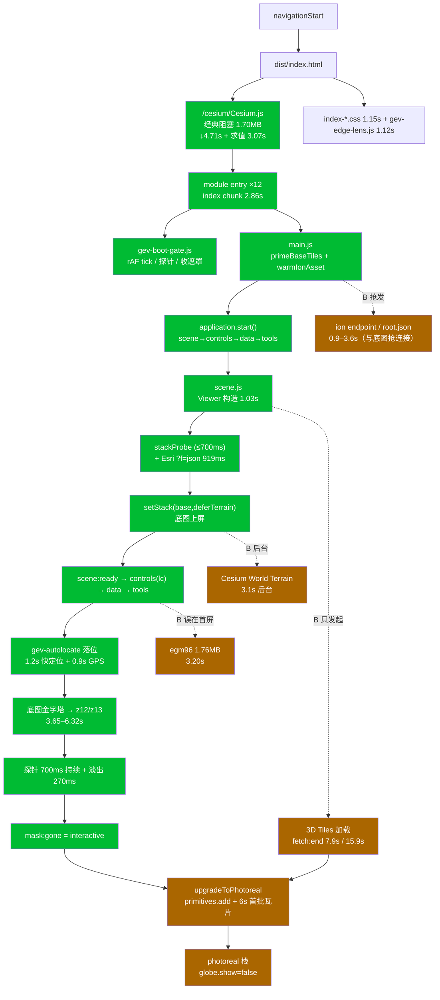

# Phase7A · 架构审查：启动依赖 / 首屏关键路径 / base-first 改造建议

- 任务卡：`t_784ca8d3`（父卡 `t_cbf4d75d`，其实现/验收报告见 `docs/Phase7A-架构审查与启动链路-20261030.md`）
- 性质：**只读审查**。本轮 0 行业务代码改动；新增 1 个只读诊断脚本（`scripts/lc/_diag/phase7a-snapshot.mjs`）。
- 环境：prod `127.0.0.1:4174`（`dist/` 2026-10-30 10:52 构建）、dev `127.0.0.1:4173`；Chrome headed，
  `renderer = ANGLE (NVIDIA GeForce RTX 3060 Laptop GPU (0x00002520) Direct3D11 vs_5_0 ps_5_0, D3D11)`，
  `powerPreference: high-performance`（本轮探针实测，非沿用旧报告）。
- 时间锚点：所有 ms 均为 `performance.now()`，0 = `navigationStart`（`src/boot-timeline.js:8-14` 口径）。

---

## 0. 结论（先行）

1. **「3D Tiles 与首屏交互绑死」的主绑定已经不存在了**：`src/app/scene.js:87-91` 现在只「发起」tileset 加载、不 `await`；
   `src/gev-boot-gate.js:392-396` 让相机在第一帧就放行。实测证据：每次冷启动 gate 都会打
   `gate:tileset:none(globe)`（prod 7484ms / dev 15457ms），因为 tileset 直到交互之后才进 `primitives`。
2. **但仍有 5 处残留绑定**（§4）：gate 里 3 条以 `tileset` 为条件的**决策分支**（其中 `no-cine` 是活的风险路径，
   一旦镜头卡住只能等 `DEADLINE_MS=26000`）、`main.js` + `scene.js` 在首屏期把 ion endpoint/root.json **提前抢发**
   （与底图抢连接）、`lc` 把「UI 就绪」的语义绑到「遮罩收起」（= gate 判定）。
3. **首屏关键路径今天由 4 个 A 类项构成，3D Tiles 已不在其中**（prod 两次实测）：
   ① `/cesium/Cesium.js` 经典阻塞脚本 4.71s 下载 + **3.07s 单条主线程任务**；
   ② 底图栈探测 + 服务元数据 0.77–1.75s（Esri `?f=json` 919ms）；
   ③ 落位后底图金字塔到 B5 清晰 **3.65–6.32s**；
   ④ `SETTLE=700ms` + 遮罩淡出 270ms + `startupChrome` 的 1s 最短展示（`src/app/startupChrome.js:29`，从 `chrome:begin`=7.44s 起算）。
4. **「≤5s interactive」在当前口径下不可达**：实测 prod 13.07s / 23.44s。根因不是 3D Tiles，而是
   **`#loading-screen` 是唯一的交互阻断器**，而它只在下述第 4 条（B5 清晰度）成立后才收。
   还有**第二道硬地板**：`src/app/startupChrome.js:29` 的 1s 最短展示从 `chrome:begin` 起算（run A = 7437.8ms），
   所以即使 B5 立刻达标，遮罩最早也在 **8.44s** 才收（+270ms 淡出）。
   要进 5s 必须同时动三件事：底图准备提前（R5/R6/R8）、1s 地板重新定位（R11）、口径决策（R1）。
   **这是产品决策，不是工程优化**（§5、§6）。
5. **一处纯 B 类被误放在首屏窗口内**：HUD 的第一个高度读数就触发 `import('egm96-universal')`
   （`src/hud.js:307-319` → `src/data/geoid.js:33-39`），这是 1.76MB chunk，prod 实测 14051.7→17249.1ms（3.20s），
   正好压在落位与金字塔爬升之间。代码里已有「网格不可用就回落」的分支（`hud.js:319`），可以整体推迟。

---

## 1. 启动依赖清单与 A/B 归类

判据：**A 类 = base imagery 上屏 + 卡片/相机可交互所必需，必须在首屏关键路径上**；
**B 类 = photoreal / terrain / 3D Tiles / 与首屏视觉无关的读数精度，可后台**。

| # | 依赖（文件:行 / 函数） | 启动期职责 | 类别 | 实测耗时（prod） | 证据 |
|---|---|---|---|---|---|
| 1 | `dist/index.html:5` `<script src="/cesium/Cesium.js">` | **head 内同步经典脚本**，5.73MB 未压缩 / 1.70MB 传输；提供 Viewer/3D Tiles/Imagery/Terrain 全量 API | **A（但过度）** | 263.6→4977.9 = **4714ms 下载** + `longTask 3067ms@7062.8` 求值 | run B 资源表 / longTasks |
| 2 | `dist/index.html:24` `/assets/index-CjLhObsW.js`（应用主 chunk，825KB） | 12 个 module entry 的公共 chunk（`index.html:48-68`） | A | 265.2→3121.3 = 2856ms | run B |
| 3 | `index.html:71` `/gev-edge-lens.js`（经典脚本，20.6KB） | 玻璃边缘折射层 | A（视觉） | 266.4→1385 = 1118ms | run B |
| 4 | `src/gev-boot-gate.js:44` `import * as Cesium` | 只用到 `Cesium.RequestScheduler`（`:90`） | A（可去掉） | prod 编译成全局 `Cesium.*` 引用（dist chunk 里是 `u=Cesium.RequestScheduler`），不额外计费；**dev 下它把整条 cesium 图拉进第一个模块** | dist chunk 反查 |
| 5 | `src/gev-boot-gate.js` `tick()` rAF 循环（`:384-575`） | 首帧放行相机（`:392-396`）、中心 640×420 readPixels 探针（`:207-288`）、收遮罩决策（`:502-556`） | A | 首帧 4958 / 10137 | marks |
| 6 | `src/main.js:14` `primeBaseTiles()` | 底图 z1..z14 中心链预取（`src/maps/baseTilePrefetch.js`） | A | 与 Cesium 抢同一 host（父卡报告 §2：端到端 0 增益） | `Phase7A…md` §2 |
| 7 | `src/main.js:23-40` `warmIonAsset` + `primePhotorealTilesetLoad` | **3D Tiles** ion endpoint + root.json 提前发起 | **B（却抢发在 A 前面）** | `warm:endpoint:begin` 3425.2→`end` 6996.9（3.57s，横跨 setStack 全程） | run A marks |
| 8 | `src/app/application.js:76-99` 串行阶段 `scene→controls→data→tools` | App 构造顺序 | A | scene:ready 7076.7→app:ready 7469.2（392ms） | run A |
| 9 | `src/app/scene.js:27-29` `resolveInitialStackId`（`src/maps/regionDetect.js:46`，2500ms 上限） | 选底图栈（Google 可达 → esri，否则 amap） | A | 与 `:98-101` 的 700ms race 共同决定：run A cine:go 4958→setStack begin 5731 = **773ms**；run B = **1749.6ms** | marks |
| 10 | `src/app/scene.js:126-129` `setStack(base, {deferTerrain:true})`（`src/maps/controller.js:170-233, 271-321`） | 底图 imagery 上屏 | A | 1892.1ms（其中 Esri `?f=json` 11893.1→12812.4 = **919ms**） | run B，topStages |
| 11 | `src/maps/controller.js:297-318` 地形 `applyTerrain()` | Cesium World Terrain（`src/maps/terrain.js:4-9`，ion asset 1） | **B** | 后台：`stack:terrain:begin` 7073→`end` 10199（3.13s，run A）；run B `layer.json` 15759→16645（886ms）、terrain 瓦片 22198→22977 | marks / resources |
| 12 | `src/app/scene.js:87-91` `loadPhotorealisticTilesetPrimed`（`src/maps/google3d.js:161-169`，`TILE_TIMEOUT_MS=12000`） | 3D Tiles 加载（只发起） | **B** | `tileset:fetch:end` 7903.5（run A）/ 15859.8（run B） | marks |
| 13 | `src/app/scene.js:212-290` `upgradeToPhotoreal()`（`:247` 等 `whenInteractive`、`:254` `primitives.add`、`:259` 6s 首批瓦片超时） | 交互后接入 Tiles 并升 photoreal 栈 | **B** | `photoreal:added` 13082.5（交互后 9ms）；`photoreal:upgrade` 19181.6（**6.1s = 超时兜底**） | marks |
| 14 | `src/gev-autolocate.js:455-533` 落位（`whenCineMayStart` `:482`、快定位 1200ms `:502`、GPS 900ms `:508`） | 相机落到本机位置 | A | `cine:go` 4958.3→`cine:done` 8416.3（3458ms，run A） | marks |
| 15 | `src/gev-autolocate.js:441-453` `announceBootCenter` / `__gevBaseTiles.center` | 底图预取中心对齐 | A | — | 代码 |
| 16 | `src/hud.js:307-319` `_geoidUndulationM` → `src/data/geoid.js:33-39` `import('egm96-universal')` | HUD 高度读数的大地水准面修正 | **B（却抢发在首屏）** | 14051.7→17249.1 = **3197ms / 1.76MB** | run B resources |
| 17 | `src/app/startupChrome.js:26-29, 37-56` | 遮罩收起 = `max(styleManager 恢复, 1000ms, gate.whenReadyToHide)` | A（地板 1s） | `chrome:begin` 7437.8→`mask:hide-request` 12805.6 | marks |
| 18 | `src/lc/index.js:48-296` 卡片层 | 9 张卡玻璃皮 + 交互绑定；`:169` 等 8 个卡元素；`:262-267` `api.ready = gate.whenInteractive` | A | `api.readyAt = 23438.9`（= `mask:gone`），此前卡片早已 mounted | run B 探针 |
| 19 | `src/lc/material.css` + `public/gev-edge-lens.js` | 单层玻璃材质/refraction | A（视觉） | — | — |

**归类结论**：A 类 12 项、B 类 4 项。B 类里 **#7（ion endpoint 抢发）与 #16（egm96 1.76MB）实际发生在首屏窗口内**，
是当前唯一还「压在交互路径上」的 B 类负载；#11（terrain）、#12/#13（3D Tiles）已经在后台。

---

## 2. 依赖图



文本树（同上，去掉样式）：

```
navigationStart
└─ index.html（head 同步经典脚本 /cesium/Cesium.js 1.70MB → 4.71s 下载 + 3.07s 求值）
   ├─ 12 个 module entry → index chunk 825KB（2.86s）
   │  ├─ gev-boot-gate.js   首帧 → cine:go；探针；收遮罩决策
   │  ├─ main.js ─ primeBaseTiles()  |  warmIonAsset + primePhotorealTileset (B 抢发)
   │  └─ application.start()
   │     scene ─ Viewer(1.03s) ─ stackProbe(≤700ms)+Esri 元数据(919ms) ─ setStack(base)
   │        └→ controls(lc 卡片) ─→ data ─→ tools ─→ app:ready
   ├─ gev-autolocate  落位(1.2s 快定位 + 0.9s GPS)
   └─ 金字塔 z12/z13 (3.65–6.32s) → 探针 700ms → 淡出 270ms → mask:gone
        └─(交互后) upgradeToPhotoreal → globals photoreal（不影响 interactive）
```

---

## 3. 首屏关键路径（实测，串行耗时点）

### 3.1 prod 4174 · run A（11:09，环境较空闲）

| 时刻 | 检查点 | 串行增量 |
|---|---|---|
| 0 | nav | — |
| **3227** | `gate:eval`（HTML+CSS+Cesium 脚本+cesium 图求值完） | **3227ms** |
| 3414 | `main:entry` / `warm:endpoint:begin`（B 抢发） | 187 |
| 4346.6→4741.5 | `viewer:construct` | 395 |
| 4928.9 | `viewer:ready` | 187 |
| **4958.3** | `frame:first` + `cine:go(base-first)` | 29 |
| **5731.2** | `basemap:setStack:begin`（stackProbe race） | **773** |
| 7073 | `stack:imagery:ready` | **1342** |
| 7076.7 | `scene:ready`；7120→7469 `controls/data/tools` + `app:ready` | 392 |
| 7484.3 | `gate:tileset:none(globe)` ← **gate 永远走 globe 分支** | — |
| 8416.3 | `cine:done`（1.2s 快定位 + 0.9s GPS + 2 rAF）= `app:ready`+947 | — |
| 10199 | `stack:terrain:end`（B 类，后台，不阻塞） | — |
| **12069.5** | `gate:view:content`（底图到 B5 清晰） | **3653** |
| 12803.5 | `gate:view:settled`（+734 ≈ SETTLE 700） | 734 |
| 13073.6 | `gate:mask:gone`（淡出 270） | **270** |
| 13082.5 | `photoreal:added`（交互后 9ms，B 类对齐） | — |
| 16125.2 / 19181.6 | `warm:root:end` / `photoreal:upgrade`（= 6s 首批瓦片超时） | B 类 |

**run A total = 13073.6ms（interactive）**；`worstFrame 1730.8ms`（遮罩内）。

### 3.2 prod 4174 · run B（11:14，环境较慢，仍可用）

| 时刻 | 检查点 | 串行增量 |
|---|---|---|
| 203.2 | `net:responseStart` | 203 |
| 263.6→4977.9 | `/cesium/Cesium.js`（1.70MB） | 4714 |
| 265.2→3121.3 | `index-*.js`（825KB） | 2856（并行） |
| **7062.8** | `net:domInteractive`；**`longTask 3067ms @7062.8`** | — |
| 7081.7 / 7410.9 | `gate:eval` / `main:entry` | — |
| 8192 | `paint:first / FCP`（= 遮罩自身） | — |
| 8748.9→9779.4 | `viewer:construct` | **1030** |
| 10137 | `gate:cine:go` | — |
| **11886.6** | `basemap:setStack:begin`（stackProbe + race） | **1749.6** |
| 13778.7 | `basemap:setStack:end`（Esri 元数据 919ms） | **1892.1** |
| 14268.5 | `app:ready` | 490 |
| **15574.9** | `gate:cine:done` | **1306.4**（相对 app:ready） |
| 14051.7→17249.1 | `egm96-universal` 1.76MB（B 类，误在首屏） | 3197（与落位重叠） |
| 15759→16645 | terrain `layer.json`（B 类后台） | 886 |
| **22179.1** | `gate:view:content`（底图 z12 到齐） | **6319.3**（相对 `tileset:fetch:end`） |
| 23073.7 | `gate:view:settled` | 894 |
| 23438.3 | `gate:mask:gone` | 365 |

**run B total = 23438.3ms**。两次跑的差别全部来自**环境方差**（`Cesium.js` 1.70MB 下载 4.71s、
Esri 瓦片 1.05s/块、`domInteractive` 6.86s）——与父卡报告 §4 的「±50% 环境方差」一致，**跨批次绝对值不可比**，
只能看同批内的阶段分解。这本身是「≤5s 必须同批 A/B」的理由。

### 3.3 dev 4173（11:12，仅作对照，不代表产品）

```
gate:eval 2772 → viewer:module-eval 10649（未打包模块图 +7.9s）→ viewer:ready 11445
→ setStack 13544.8→14756.1 → app:ready 15442.6 → cine:done 17700.3
→ view:content 20643.7 → settled 21348.2 → mask:gone 21610.3
```
**dev 的模块图（+7.9s）是 dev 独有项**；prod 用打包 chunk 后这一项消失（3280−3227 = 53ms）。
因此 **dev 数据不能用于「≤5s」判定**，也不能与 prod 混算。

---

## 4. 绑定点定位（3D Tiles ↔ 首屏交互）

### 4.1 已经解耦（有实测证据，勿回退）

| 位置 | 现在 | 证据 |
|---|---|---|
| `src/app/scene.js:87-91` | `loadPhotorealisticTilesetPrimed(...)` 只赋值 `photorealPromise`，**不 await**；底图 `setStack` 立即执行 | `stack:imagery:ready` 7073 早于 `tileset:fetch:end` 7903 |
| `src/app/scene.js:126-129` | 首屏只 `setStack(initialStackId, {deferTerrain:true})` | `scene:ready` 7076.7 |
| `src/gev-boot-gate.js:392-396` | 首帧无条件 `fire('cineMayStart')` | `gate:cine:go(base-first)` 4958.3 |
| `src/app/scene.js:247` | **B 等 A**：`await whenInteractive()` 之后才 `primitives.add` | `photoreal:added` 13082.5 = interactive 后 9ms |
| `src/maps/tileWarmup.js:110-116` | Tiles 瓦片预取挪到 `__gevBoot.whenInteractive`（15s 兜底） | `warm:root:begin` 13079.6（交互后 6ms） |

### 4.2 仍在绑死 / 残留绑定（必须处理）

| # | 位置（文件:行 / 函数） | 绑定机制 | 实测证据 | 影响 | 严重度 |
|---|---|---|---|---|---|
| **B-1** | `src/gev-boot-gate.js:559-567`（`no-cine` 分支要求 `tileset &&`） | 收遮罩的兜底路径以 tileset 存在为条件；base-first 下 tileset 永远不在场景里 → 该分支**不可达** | 每次启动只出现 `gate:tileset:none(globe)`；`gate.snapshot().tilesetAt` 一直是 7484 的 `none(globe)` | 镜头卡住（定位失败/分享链接异常）时**没有早退路径**，只能等 `DEADLINE_MS=26000`（`:58`）收遮罩 → 用户 26s 白屏 | **高（活路径）** |
| **B-2** | `src/gev-boot-gate.js:471-478`（`cine:go(tileset)`，依赖 `FRAMES_BEFORE_CINE=2`、`CINE_MAX_WAIT_MS=9000`） | 相机放行的**第二条**通路仍然以 tileset 进场景为条件 | 该 mark 从未出现（只有 `cine:go(base-first)`） | 死代码，但只要有人回退 `:395` 那一行，相机立刻重新绑回 Tiles；且它掩盖了「谁真正放行相机」的语义 | 中（回归陷阱） |
| **B-3** | `src/gev-boot-gate.js:521-544`（`allLoaded = tileset.tilesLoaded` → `decide('tiles-loaded')`） | 收遮罩决策表里仍有一条由 3D Tiles 状态直接判定「可以收」的路 | 未触发（tileset 为 null） | 若将来把 tileset 提前 add（例如为削长帧做「隐藏预热」），遮罩会**在 photoreal 就绪时收起**，B5 清晰度判据被旁路 —— 等于把 3D Tiles 偷偷绑回首屏 | 中（未来事故） |
| **B-4** | `src/main.js:33-39` + `src/app/scene.js:87-91` + `src/maps/google3d.js:161-169` | 3D Tiles 的 ion endpoint / root.json 在 `main:entry` 与 `scene:begin` 就发（C4 的抢跑优化），**早于底图** | run A `warm:endpoint:begin` 3425.2 → `end` 6996.9（3.57s），全程与 `setStack` 重叠；run B `/v1/assets/2275207/endpoint` 7420→8358（938ms） | 与底图共享连接池/带宽；父卡报告 §3 已证明「遮罩期 3D 瓦片预取抢底图」是实打实的 −625ms 损失，endpoint 这一条还在 | 中 |
| **B-5** | `src/lc/index.js:262-267`（`api.ready` = `gate.whenInteractive`） | 「卡片层就绪」的**语义**绑在遮罩收起上，而遮罩收起 = gate 的 B5 判定 | `api.readyAt = 23438.9` == `gate:mask:gone`；而卡片 DOM 在 `app:phase:controls`（13828.4）就齐了 | 任何用 `__lc.api.ready` 度量「可交互」的验收，**在结构上就不可能 ≤5s**；也掩盖了卡片其实 7–14s 就能点 | **高（度量污染）** |
| **B-6** | `src/hud.js:307-319` → `src/data/geoid.js:33-39` | HUD 首个高度读数触发 1.76MB `egm96` 动态 import | run B 14051.7→17249.1（3.20s，与落位/金字塔重叠） | 不是 3D Tiles，但同属「B 类压 A 类」，是首屏窗口内最大的一笔非必要下载 | 中 |

> 结论（不允许留空）：**主绑定已解，残留 6 处**。其中 B-1、B-5 是**当前就有害**的，
> B-2/B-3 是**回归陷阱**（会让 3D Tiles 重新绑回首屏），B-4/B-6 是**带宽/主线程竞争**。

---

## 5. 「≤5s 的 interactive」判定标准（可执行口径）

### 5.1 定义

设 `T` 为导航开始后的第一个时刻，当且仅当以下 4 条**同时**成立，记 `T = T_interactive`：

| # | 判据 | 可断言对象（DOM / 事件） |
|---|---|---|
| 1 | 遮罩不再拦截输入 | `#loading-screen` 的 `getComputedStyle().opacity ≤ 0.05`（或 `display:none`）；对应 `window.__gevBoot.interactive === true`、`__bootTimeline` mark `gate:mask:gone` |
| 2 | 卡片层就绪且可点 | `window.__lc.api.mounted === true` **且** `CARD_IDS`（8 张展开卡）的 DOM 全在（`src/lc/index.js:169` 的 `waitReady` 判据）**且** 一次真实 `pointerdown/pointerup` 后 `__lc.api.phases()[id]` 由 `mini` 变 `opening`（`interaction.bind` 已于 `src/lc/index.js:194` 完成） |
| 3 | 地图可操作 | `window.__gevViewer` 存在、`scene.globe.show === true`、且 `scene.mapStackController.getActiveId() ∈ {amap-satellite, amap-hybrid, esri-imagery, osm}`（A 类栈已激活，可拖拽/滚轮） |
| 4 | 不是纯色/白屏 | 最近一次中心 **640×420** readPixels 探针 `ok === true`（`std ≥ 18 && uniq ≥ 800`，与 gate B5 同口径，`src/gev-boot-gate.js:188-192`） |

**锚点**：`navigationStart`（`performance.timeOrigin`）。**报告值**：`__bootTimeline.snapshot()` 中 `gate:mask:gone` 的 `t`。
**明确排除**：3D Tiles / photoreal / terrain / egm96 —— 它们是 B 类，另有独立门：
`__gevPhotoreal.ready === true`（基准 ≤30s，实测 19.2s，且必须在 `T_interactive` 之后）。

### 5.2 为什么这 4 条这么定

- 第 1 条是唯一真正的「交互阻断」：`#loading-screen` 是 `position:fixed; inset:0` 的不透明层（`gev-boot-gate.js:19` 注释）；
- 第 2/3 条是「可交互」的定义本身（能点卡、能拖图）；
- 第 4 条是**防止用「白屏可交互」骗过判据**（C3-R3 的病）：没有它，只要 3s 收遮罩就能宣称 ≤5s。

### 5.3 现状与两个口径

| 口径 | 判据 | 实测 prod |
|---|---|---|
| **v1 = 1+2+3+4（当前 gate 的实际口径）** | 遮罩收起且中心 B5 清晰 | **13.07s / 23.44s**（run A / B） |
| **v0 = 1+2+3（不要求 B5）** | 遮罩收起即可交互（画面可能是粗 LOD） | 理论下界 = `max(app:ready, chrome:begin+1000ms)` = **8.44s / 15.27s**（run A / B）；要进 5s 还要靠 R5+R6+R8+R11 把 A 类前段再压 3.4–4.5s |

> 注：v0 也到不了 5s —— `chrome:begin` 本身就在 `app:ready` 附近（7.44s / 14.23s），
> `startupChrome` 的 1s 最短展示（`:29`）叠在它后面。**所以「5s」不只是判据问题，还需要把 A 类前段整体前移**（R5/R6/R8/R11）。

**结论：`≤5s` 只能在 v0 口径下谈，且必须同时对两件事做决策**：
(a) 遮罩可以在「底图粗 LOD」时收（放弃「收起即清晰」）；或
(b) 遮罩保留，但在 `T=5s` 时把 `pointer-events` 放开（交互穿透），B5 只决定视觉观感。
两者都是产品口径变更，**工程侧无法单方面达成**（§6-R1 的取舍）。这一点与 C4 报告 §「交 lead 的决策」完全一致。

---

## 6. base-first + photoreal-background 改造建议清单

按「收益/风险」排序。每条都给**涉及文件**、**动作**、**风险**、**预期收益（同批 A/B 前为估计）**。

| # | 动作 | 涉及文件 | 预期收益 | 风险 |
|---|---|---|---|---|
| **R1**（决策，非代码） | 把「可交互」与「收起即清晰」解耦：`5s` 判 v0（§5.3），B5 另设 ≤8s 视觉门；或保留遮罩但 5s 放开 `pointer-events` | `src/gev-boot-gate.js`（判据）、`src/app/startupChrome.js:37-56`、验收脚本 `scripts/lc/phase7a-cold.mjs` | 这是**唯一**能进 5s 的路；不决策则 ≤5s 永久 FAIL | **口径风险**：与 AGENTS「遮罩收起不得是纯色」冲突，需 lead 书面改判 |
| **R2** | 清掉 3 条残留绑定：删除 `cine:go(tileset)` 通路（`:471-478` + `FRAMES_BEFORE_CINE`/`CINE_MAX_WAIT_MS`）、`decide('tiles-loaded')`（`:521-544`）、`no-cine` 的 `tileset &&`（`:561`）；`globeOnly` 分支改名为 `base-first` 明确语义 | `src/gev-boot-gate.js` | 消除「镜头卡住等 26s」的活路径；消除 B-2/B-3 回归陷阱；mark 语义不再误导验收 | 低（三条在实测中均不可达）；需同步 gate 断言里对 `tilesetAt`/`globeOnly` 的引用 |
| **R3** | 拆开 `lc.api.ready`：新增 `api.interactiveAt`（= §5 判据 1+2）与 `api.ready`（保留旧语义但标注 deprecated），`interactiveAt` 由 `mask:gone` + `mounted` 双条件及时取 | `src/lc/index.js:256-267`、`scripts/lc/phase7a-cold.mjs`、`scripts/lc/_diag/phase7a-snapshot.mjs` | 让「≤5s」可被正确度量（现口径结构上不可达） | 低-中：所有读 `__lc.api.ready` 的脚本要同步改；不改则数字继续失真 |
| **R4** | HUD geoid 延后：`_geoidUndulationM` 在 `__gevBoot.interactive` 之后（或 `requestIdleCallback`）才 `ensureGeoidReady()`，之前返回 `null`（已有回落分支） | `src/hud.js:307-319` | 首屏窗口少 **3.20s / 1.76MB** 的下载+解析（run B 实测值） | 低：高度读数在交互前显示未修正值（差 ~30m 量级），HUD 有既有 `null` 回落 |
| **R5** | 底图栈探测改为「记住上次栈立即上屏」：`localStorage['gev.lastStack']` 命中则 0ms 用，`resolveInitialStackId` 结果回来再切；未命中才走 700ms race | `src/app/scene.js:27-29, 98-101`、`src/maps/regionDetect.js` | 省 0.77–1.75s（run A/B 实测的 `cine:go → setStack:begin`） | 中：跨区域漫游时首个栈可能不是最优（已有 `constructionFallback`/`tileFailureFallback` 兜底），会有一次可见切换 |
| **R6** | Esri 元数据加超时兜底：`?f=json` 超 400ms 即 `constructionFallback → amap-satellite`（现在只在**构造抛错**时兜底，超时不抛） | `src/maps/defaultSources.js:63-78`、`src/maps/controller.js:338-359` | 省最多 919ms（run B 实测） | 中：偶发首屏落 AMap 而非 Esri（视觉差异，均属 A 类底图） |
| **R7** | ion endpoint 不再早于底图：`main.js:34` 的 `warmIonAsset` 延到 `stack:imagery:ready`（或直接复用 `whenInteractive` 前的 `requestIdleCallback`） | `src/main.js:23-40`、`src/maps/tileWarmup.js:124-176` | 底图爬升期少一条同源长连接（父卡报告 §3 已证明同类争抢 −625ms） | 低-中：photoreal 就绪时间再推后 ~1–3s（B 类，已有 `__gevPhotoreal` 诊断与 30s 门） |
| **R8** | `/cesium/Cesium.js` 去阻塞：`dist/index.html:5` 的经典脚本加 `defer`（改 vite 构建模板注入点，不改业务 js） | 构建模板（`dist/index.html` 的生成处，需定位插件/模板）、`index.html` 对应的 build 配置 | HTML 解析不再被 5.73MB 脚本阻塞；`paint:FCP` 提前（run B FCP 8.2s 里有相当一部分是解析阻塞） | **中-高**：module 脚本在 `defer` 队列之后执行，若顺序被破坏，模块求值时会读到未定义的全局 `Cesium`（dist chunk 直接 `Cesium.RequestScheduler`）。必须 A/B 验证 `gate:eval` 不后移 |
| **R9** | photoreal 升级削长帧：`primitives.add` 前用离屏预编译/`requestIdleCallback`，或把 `whenTilesetContent` 从 6s 超时改为「首批瓦片真到」再切 `globe.show=false` | `src/app/scene.js:247-264`、`src/gev-boot-gate.js:116-133`（`armPhotorealWatch`） | 交互后 `longTask 756ms@18.4s / 401ms@19.2s`（run B）削掉一部分 | **中-高**：与「无 >100ms 长帧」的 FPS 卡口径正面冲突（B 类工作必须有地方执行）；需 lead 在「≤5s」「无长帧」「不降画质」三者间排序 |
| **R10** | 底图金字塔到 B5 的 3.65–6.32s：**不要**用降 LOD/降清晰度换（违反 B5/不降级）；可试 `globe.tileCacheSize`↑ + 落位前预取 z13 视野环（父卡报告 §2 已证 ring 会与 Cesium 抢 host，需限 1 条连接） | `src/app/viewer.js`、`src/maps/baseTilePrefetch.js` | 未知，需 A/B | 中：父卡已证「单纯预取端到端 0 增益」，不要重复投入；若 A/B 无收益即停 |
| **R11** | 1s 最短展示重新定位：`minimumDelay` 的起点从 `chrome:begin` 改到更早的锚点（`scene:begin` 或 `navigationStart`），或按「已展示 ≥1s」判断而不是「chrome 开始后 1s」 | `src/app/startupChrome.js:26-29` | 地板 −0.4~2.5s（取决于锚点前移多少） | **中**：这是刻意的 UX 地板（避免闪一下就没）；改锚点不删地板，视觉上等价，但必须视觉复核 |

**执行顺序建议**：R2 + R3（0 风险、立刻让度量变真）→ R4 + R7（纯 B 类搬走）→ R5 + R6 + R11（A 类前段省 1.2–4.2s）→ R1（要 lead 签字）→ R8/R9/R10（各需独立 A/B 卡）。

---

## 7. 依据与复现

**引用依据**
- `Phase6C6-最终验收报告-20261030.md`（`.gev-logs/lc/phase6c6/`）：prod 6 次冷启动 loading **12.46 / 15.35 / 16.93 / 15.10 / 17.24s**（中位 16.04，`0/6 ≤5s`）；
  遮罩收起中心 B5 6/6 PASS；真实地图色散 **0/36 边达 JND**；
  项8 判定 `FAIL`（loading 0/6、>100ms 4/6、fps 高于 60 上限）。
- **口径更正（重要）**：本卡正文引用的「prod 3D Tiles 冷启动 8–9s、dev 10–13s」在源文件里对应的其实是
  `Phase6C4-报告-20261030.md:86` 的「**接受新地板（prod ~8–9s / dev ~12–13s）**」——那是**整段 loading 的地板估计**，
  不是「3D Tiles 单独的冷启动耗时」。本轮实测 3D Tiles 侧的量是 `tileset:fetch:end` 7.9s / 15.9s（含 ion endpoint），
  `photoreal:upgrade` 19.2s（6s 首批瓦片超时兜底）。建议后续报告统一改称「loading 地板」。
- 本轮实测原始数据：`.gev-logs/lc/_p7a_deps_prod.json`（prod 全量 snapshot：marks/stages/longTasks/resources/gate 探针）。

**复现**
```bash
# 逐阶段时间线（既有）
node scripts/lc/_diag/phase7a-trace.mjs 'http://127.0.0.1:4174/?welcome=0'
# 全量 snapshot（本轮新增，只读）
node scripts/lc/_diag/phase7a-snapshot.mjs 'http://127.0.0.1:4174/?welcome=0' '.gev-logs/lc/_p7a_deps_prod.json'
```

---

## 8. 未验证 / 风险（不隐藏）

1. **样本量**：prod 只跑了 2 次（13.07s / 23.44s）、dev 1 次。本报告的所有**结论**都只依赖「同一次运行的阶段相对关系」，
   不依赖绝对值；但 R5/R6/R8 的收益必须在**同批 A/B（各 ≥3 跑）**下复核，否则会被 ±50% 环境方差吃掉。
2. **R8（`defer` Cesium.js）未做原型**：只做了代码结构与资源定位，没有验证 `defer` 后模块求值顺序是否仍安全。
   落地前必须在独立卡上 A/B，判据是 `gate:eval` 不前移、`paint:FCP` 前移。
3. **`worstFrame` 1730–3054ms**：来自 gate 的 rAF 帧间隔，全部落在 `maskOp=1.0`（遮罩内），用户不可见；
   但它的成因（Cesium.js 求值 3067ms / viewer 构造 1730ms）说明**首屏期仍有秒级主线程块**，这是 R8 与「≤5s」的物理下界。
4. **`lc.api.ready` 语义**：本报告判它「绑死」，但它是 C3 就定下的验收口径（`t` 系列 gate 脚本依赖它）。
   改它属于验收口径变更，不是单纯重构 —— 必须与 R1 一起由 lead 确认。
5. **地形/瓦片的 ion endpoint 归属**：`/v1/assets/1/endpoint`（terrain）与 `/v1/assets/2275207/endpoint`（photoreal）同源，
   同源连接池竞争只做了时序观察（两者在 7.4–16.6s 区间重叠），未做「关掉 terrain 看底图快多少」的 A/B —— 若 R7 落地建议顺带验。
